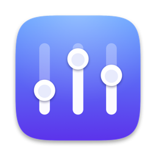
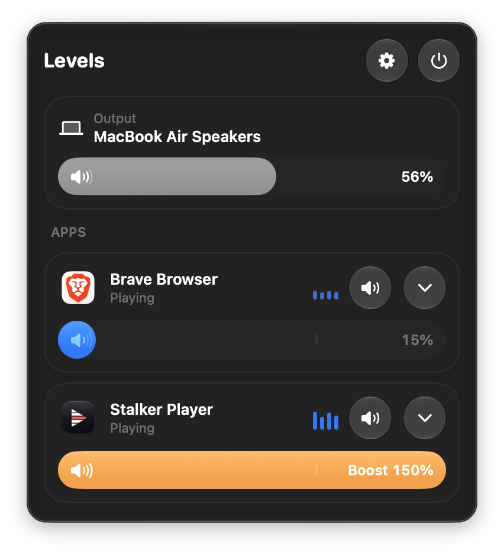
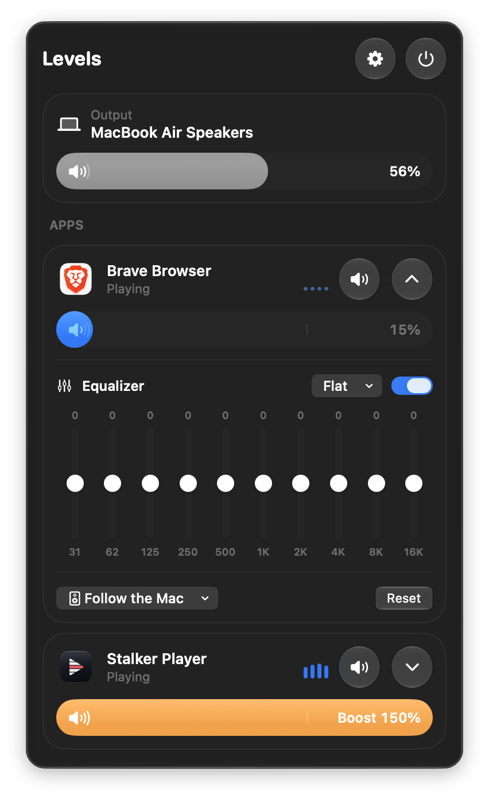

<p align="center">
  
</p>

<h1 align="center">Levels</h1>

<p align="center">
  <strong>A volume knob, an equalizer and an output chooser for every app on your Mac, right in the menu bar.</strong>
</p>

<p align="center">
  
  
  
  
</p>

<p align="center">
  <a href="#features">Features</a> &nbsp;·&nbsp;
  <a href="#install">Install</a> &nbsp;·&nbsp;
  <a href="#faq">FAQ</a> &nbsp;·&nbsp;
  <a href="#build-from-source">Build</a> &nbsp;·&nbsp;
  <a href="#how-it-works">How it works</a>
</p>

<p align="center">
  
  &nbsp;&nbsp;&nbsp;
  
</p>

Turn Safari down while music plays. Silence a noisy tab for good. Boost a quiet video to 150%. Shape a podcast with a
ten-band equalizer. Send music to your speakers and a call to your headphones at the same time.

Levels is free and light: about a megabyte, with no audio driver to install and no account to make. It never records
your sound or sends it anywhere.

## Features

| | |
|---|---|
| **A volume for every app** | From 0 to 150%. Above 100% a soft limiter stops clipping, and a haptic click marks 100% as you drag past it. |
| **Mute in one click** | Silence any app without touching its own controls. |
| **An equalizer for each app** | Ten bands, 31 Hz to 16 kHz, plus or minus 12 dB, with presets: Flat, Voice, Bass Boost, Treble Boost, Night, Music. |
| **Choose where each app plays** | Follow the Mac, or send one app to any output: speakers, AirPods, a display. |
| **System volume and output** | Right at the top of the panel, so you never leave it. |
| **Live level meters** | Drawn in decibels, so ordinary music fills them instead of looking dead. |
| **Browsers shown as one app** | Browsers play sound from helper processes. Levels groups them under the app you launched, so Brave and Safari each get one row. |
| **FaceTime and phone calls** | Apple plays call audio from background services, so calls get their own "FaceTime & Calls" row. |
| **Only what is happening now** | An app is listed while it makes sound, and gone when it stops. Your changes are remembered and return the next time that app plays. |
| **Settings you can trust** | Every app you changed is listed in Settings with its own Reset button, plus Reset All. Optional Open Levels at login. |

## Install

**Requirements:** macOS 26 or later on an Apple silicon Mac.

1. Download `Levels-1.1.zip` from the [Releases](https://github.com/Nurik-dz/Levels/releases) page and unzip it.
2. Drag `Levels.app` into your Applications folder.
3. Levels is signed ad hoc and is not notarized, because it does not use a paid Apple Developer membership. macOS
   therefore blocks the first launch. Open Levels once, then go to **System Settings, Privacy & Security** and press
   **Open Anyway**. Or clear the quarantine flag in Terminal:

   ```
   xattr -dr com.apple.quarantine /Applications/Levels.app
   ```

4. Open Levels. Its icon appears in the menu bar. When macOS asks, allow it to capture audio. That permission is listed
   under **Privacy & Security, Screen & System Audio Recording**.

## FAQ

**Does Levels record my audio?**
No. Levels reads an app's sound in memory to draw its meter and to apply your volume and equalizer. It never writes
sound to disk, and it contains no networking code at all.

**Why does macOS call the permission "Screen & System Audio Recording"?**
It is the one permission macOS offers for reading another app's sound. Levels does not capture your screen.

**An app I want is not in the list.**
Levels lists apps while they are making sound. Start playing in that app and its row appears. When it stops, the row
goes away, but your settings for it are kept.

**I set an app to 0% and now it is silent.**
That is what you asked for. The app comes back as a row the moment it plays, and **Settings** lists every app you
changed, each with a Reset button.

**Which sound does Levels change?**
Only apps you adjusted. Everything else plays untouched, exactly as before.

## Build from source

You need only the Command Line Tools. Xcode is not required.

```
git clone https://github.com/Nurik-dz/Levels.git
cd Levels
./build.sh          # produces build/Levels.app, ad-hoc signed
```

`build.sh` compiles against the macOS 26.5 SDK inside the Command Line Tools (see `SDK=` at the top, and change it if
yours is named differently). It stays on a 26.x SDK because SDK 27 turns `@State` into a macro whose plugin ships only
with Xcode.

The app is signed to its identity (`designated => identifier "com.nurik.levels"`) instead of to one build, so macOS keeps
the audio permission when you rebuild. If you fork the project under your own name, change the bundle identifier in
`Info.plist` and `build.sh` together.

## How it works

Levels changes each app's sound without a driver, using Core Audio **process taps** (macOS 14.2 and later):

1. The Mac lists every audio process with its process ID, its bundle ID and whether it is outputting sound.
2. For an app you changed, Levels taps all of that app's processes, muting them at the source, inside a private
   aggregate device that also holds the output you chose. An I/O callback reads the tapped sound, applies volume, the
   equalizer and the limiter, and plays it to that output.
3. Apps you did not change are never touched. While the panel is open, apps that are playing get a listen-only tap for
   their meter, and those taps are dropped when it closes.
4. The audio thread never allocates, and slider changes reach it through a try-lock, so dragging a slider cannot
   stutter the sound.

```
Sources/
  App/      the menu bar app and its windows
  Engine/   Core Audio helpers, process taps, DSP (volume, ten-band EQ, limiter), the model
  Model/    saved per-app settings
  Views/    the SwiftUI panel, controls, Settings and the welcome screen
```

The app icon is drawn in code (`tools/make_icon.swift`).

## Tests

```
./run_tests.sh VisibilityTest     # which apps are listed: pure logic, fast, silent
./run_snap.sh                     # draws every screen off-screen into build/snap, using a throwaway home folder
```

`Tests/EngineTest.swift` and `Tests/ModelTest.swift` measure the real audio path with a tiny app that plays a tone.
Build it with `tools/ToneApp/build.sh`, then run `./run_tests.sh ModelTest build/ToneApp.app`. They play a tone through
your speakers, so run them when nothing else is playing.

Off-screen pictures cannot draw Liquid Glass, so check the glass look on a real screen.

## Known limits

- **Calls:** FaceTime and phone calls are confirmed. Calls in WhatsApp, Zoom, Teams, Discord and Meet are untested.
- **Copy-protected audio** is untested.
- Levels needs macOS 26 for its glass controls, even though process taps themselves start at macOS 14.2.

## License

MIT. See [LICENSE](LICENSE).
